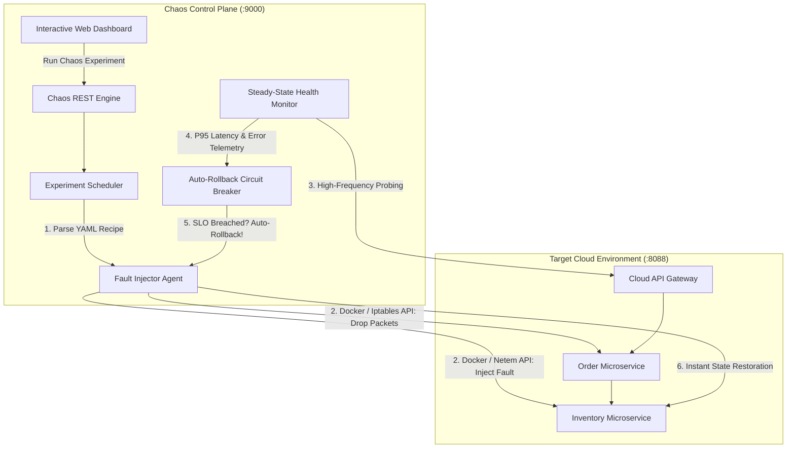

# Automated Cloud Chaos Engineering Engine (Group 17)
### System Design Abstraction Layer over Cloud Control Planes & VPC Networks

This project implements an enterprise-grade **Chaos Engineering Control Plane** that safely injects infrastructure faults (compute instance termination, cross-AZ network latency, and VPC security group partitions) into a containerized microservices fleet, continuously monitors real-time Service Level Objectives (SLOs), and automatically executes emergency rollbacks via an automated Circuit Breaker when thresholds are violated.

---

## 🏗️ Architecture Overview



---

## 🚀 Quickstart Guide

### Prerequisites
* Docker 20.10+
* Docker Compose v2+
* Python 3.8+ (for local test script)

### 1. Launch the Environment
```bash
cd "acc projects/17/chaos_engineering_project"
cp .env.example .env
./start.sh
```

### 2. Access the Applications
* **Chaos Control Plane Dashboard:** [http://localhost:9000](http://localhost:9000)
* **Target Cloud Ingress (API Gateway):** [http://localhost:8088](http://localhost:8088)
* **Aggregated Health Endpoint:** [http://localhost:8088/health](http://localhost:8088/health)
* **Real-Time Telemetry / Metrics:** [http://localhost:8088/metrics](http://localhost:8088/metrics)

### 3. Run the Automated Resilience Verification
To execute a fully automated verification test that validates fault injection, SLO breach detection, and auto-rollback:
```bash
python3 test_demo.py
```

### 4. Teardown
```bash
./stop.sh
```

## 🎓 Presentation runbook

Use this sequence in a live demonstration:

1. Open the dashboard and show all three target services as `HEALTHY`.
2. Open `/healthz` and `/api/config` to show the control plane runtime and deployment mode.
3. Click **Run Experiment** for `01_instance_termination`.
4. Point out the inventory service changing to `DOWN`, the order dependency becoming `DEGRADED`, and the SLO telemetry rising.
5. Show the circuit breaker changing from `MONITORING` to `TRIPPED`.
6. Show the audit log entry for automatic rollback and the services returning to `HEALTHY`.
7. Run `python3 test_demo.py` afterward as a repeatable evidence artifact.

For a deterministic terminal-only proof, run:

```bash
python3 test_demo.py
```

The verifier exits with status `0` only when it observes both a circuit-breaker trip and post-rollback recovery. Set `CHAOS_URL`, `GATEWAY_URL`, and `CHAOS_API_TOKEN` when running it against the AWS host.

## ☁️ Cloud deployment

The project includes an AWS EC2 deployment under `deploy/aws-ec2/`. It provisions a restricted security group, installs Docker on Ubuntu, and gives you a repeatable path to upload and run this same Compose project on a real cloud VM. Read [`deploy/aws-ec2/README.md`](deploy/aws-ec2/README.md) before applying it.

The honest architecture boundary is important for your viva: EC2 is the cloud compute primitive; Docker is the target workload runtime; the Group 17 abstraction layer schedules experiments, injects faults through the Docker API/Linux networking tools, measures SLOs, and rolls back automatically. This implementation demonstrates a single-cloud-host failure domain. It does not claim multi-node Kubernetes orchestration, durable order storage, or production-grade authorization.

When port 9000 is exposed beyond localhost, set `CHAOS_API_TOKEN` in `.env`. The dashboard has a token field and state-changing endpoints require `X-Chaos-Token`; read-only telemetry remains public to the permitted network.

## 🧭 Operational endpoints

| Endpoint | Purpose |
| --- | --- |
| `GET /healthz` | Control-plane health for Docker/EC2 checks |
| `GET /api/config` | Deployment mode, provider, and Docker runtime visibility |
| `GET /api/status` | Live telemetry, experiment, circuit-breaker, and active-fault state |
| `POST /api/experiments/{id}/run` | Start a declarative experiment; protected when a token is configured |
| `POST /api/rollback` | Emergency rollback; protected when a token is configured |

---

## 🧪 Included Chaos Experiments

| File | Target | Injected Fault | Steady-State SLO | Rollback Mechanism |
| :--- | :--- | :--- | :--- | :--- |
| `01_instance_termination.yaml` | `inventory-service` | Forceful container kill (EC2 crash) | Error Rate $\le 15\%$, Latency $\le 800\text{ms}$ | Auto-restart container |
| `02_cross_az_latency.yaml` | `order-service` | +800ms packet delay via `tc netem` | P95 Latency $\le 600\text{ms}$ | Clear `tc` queue discipline |
| `03_security_group_partition.yaml` | `inventory-service` | Inbound packet drop via `iptables` | Error Rate $\le 10\%$, Latency $\le 1000\text{ms}$ | Flush `iptables` filter |
| `04_cpu_exhaustion_stress.yaml` | `gateway` | 100% CPU starvation loops | Error Rate $\le 20\%$, Latency $\le 1200\text{ms}$ | Process kill stress workers |

---

## 📂 Project Structure
```
chaos_engineering_project/
├── docker-compose.yml          # Containerized orchestration of all services
├── start.sh                    # 1-command startup and health checker
├── stop.sh                     # Graceful shutdown & state cleanup
├── test_demo.py                # Automated Python test harness
├── README.md                   # Quickstart and usage manual
├── target-app/                 # Application 1: Distributed Microservice Fleet
│   ├── Dockerfile
│   ├── requirements.txt
│   ├── gateway.py              # Public Ingress & telemetry aggregator (:8088)
│   ├── order_service.py        # Order processing & timeout handler (:5001)
│   ├── inventory_service.py    # Product catalog & stock state (:5002)
│   └── entrypoint.sh
├── chaos-engine/               # Application 2: Chaos Control Plane (:9000)
│   ├── Dockerfile
│   ├── requirements.txt
│   ├── main.py                 # FastAPI engine, background prober & Web UI
│   ├── core/
│   │   ├── scheduler.py        # YAML experiment parser & validator
│   │   ├── injector.py         # Docker API & Linux Netem/Iptables fault injector
│   │   ├── monitor.py          # Real-time health prober & telemetry calculator
│   │   └── circuit_breaker.py  # Guardrail & auto-rollback circuit breaker
│   ├── templates/index.html    # Interactive Web Dashboard
│   └── static/css & js
└── experiments/                # Declarative YAML experiment recipes
```
