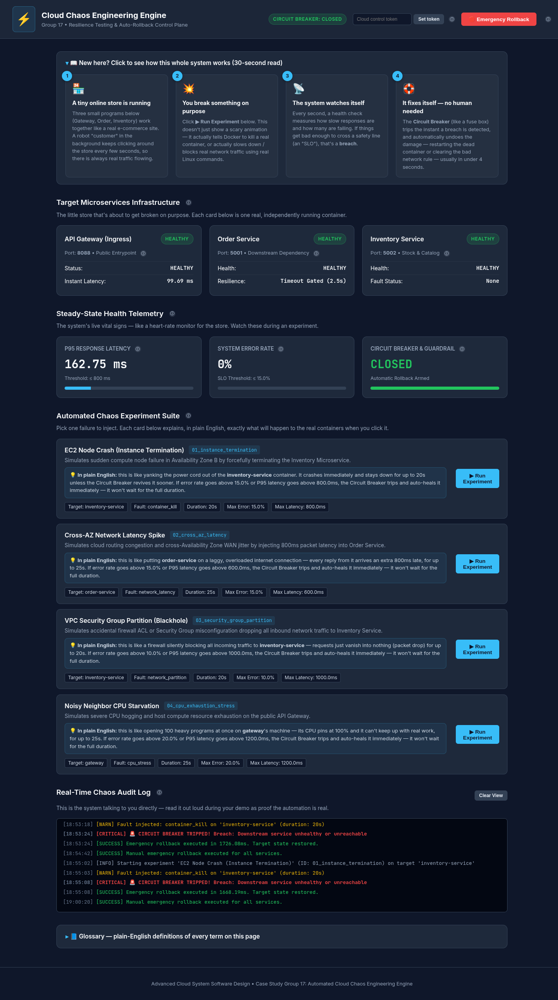
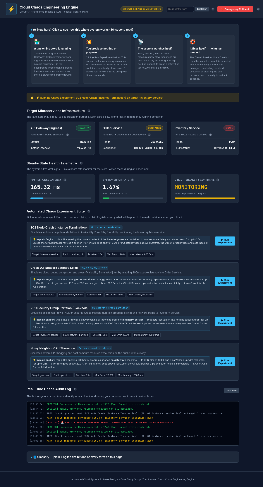
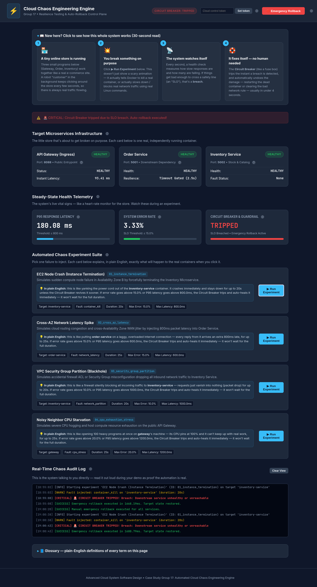
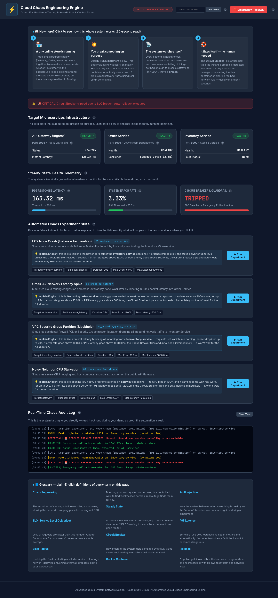

# Group 17 — Automated Cloud Chaos Engineering Engine
### Student presentation guide: what it is, what services it uses, how it's used, where it runs

This document is built from the actual running system (screenshots and a video below are real captures, not mockups) so you can walk your teacher through it with confidence.

---

## 1. The one-sentence pitch

> "We built a system that deliberately breaks a real cloud microservices app on purpose, measures the real damage, and automatically heals itself in under 4 seconds — without any human clicking anything."

That's **Chaos Engineering**: instead of only testing that software works when everything is healthy, you intentionally inject failure to prove the system survives it.

---

## 2. What services/technologies are used

| Layer | Technology | What it's for |
|---|---|---|
| Microservices | **Python 3.11 + FastAPI + Uvicorn** | The 3 target services (gateway, order, inventory) and the control plane itself |
| Inter-service calls | **httpx (async HTTP client)** | Gateway → Order → Inventory calls, with real timeouts |
| Containerization | **Docker + Docker Compose** | Packages and runs all 4 services as isolated containers on one bridge network (`chaos-net`) |
| Fault injection (compute) | **Docker Engine API** (via the `docker` Python SDK) | Actually stops/starts containers to simulate a crashed server |
| Fault injection (network) | **Linux `tc` / `netem`** | Actually adds kernel-level packet delay (simulates slow cross-region network) |
| Fault injection (firewall) | **Linux `iptables`** | Actually drops inbound packets (simulates a security-group misconfiguration) |
| Fault injection (CPU) | **Shell busy-loops via `exec`** | Actually pins a container's CPU to 100% |
| Experiment definitions | **YAML** | Declarative recipes: what to break, for how long, what "too broken" means |
| Dashboard | **HTML/CSS/vanilla JS + Jinja2 templates** | Live web UI, polls the backend every second |
| Optional real cloud | **AWS EC2 + Terraform** | Runs the exact same Docker stack on a real cloud virtual machine instead of a laptop |
| **Kubernetes** | **Not used** (by design) | This is intentionally single-host Docker Compose, not a multi-node orchestrator — be upfront about this if asked |

---

## 3. Architecture — two cooperating applications

**App 1 — Target Workload** (the "victim store"), port 8088:

- `gateway.py` — public entry point; proxies requests; times every real request to compute real P50/P95/P99 latency and error rate
- `order_service.py` — places orders, calls Inventory to reserve stock, times out after 2.5s if Inventory doesn't answer
- `inventory_service.py` — the product catalog & stock counts

**App 2 — Chaos Control Plane** (the actual engineering contribution), port 9000:

- **Scheduler** (`core/scheduler.py`) — loads YAML experiment recipes
- **Fault Injector** (`core/injector.py`) — talks to the real Docker API to kill containers / run `tc`+`iptables` inside them
- **Health Monitor** (`core/monitor.py`) — probes the gateway every second, computes real error-rate/P95 from a live 60-sample window
- **Circuit Breaker** (`core/circuit_breaker.py`) — the guardrail: compares live metrics against the experiment's safety thresholds (SLO) and auto-rolls-back the instant they're breached
- **Dashboard** (`main.py` + `templates/index.html`) — shows all of the above live, lets you click to run an experiment

A background task also continuously generates **real traffic** (viewing products, placing checkouts) so there's always genuine data flowing — nothing shown on the dashboard is a random/fake number.

---

## 4. How it's used — the demo walkthrough (with real screenshots)

### Step 1 — Baseline: everything healthy
All 3 service cards show `HEALTHY`, the Circuit Breaker reads `CLOSED` (armed, normal operation). Note the beginner-friendly "How this works" walkthrough at the top and the ⓘ tooltips on every metric — these exist so a non-technical viewer can follow along.



### Step 2 — Inject a real fault
Clicking **▶ Run Experiment** on "EC2 Node Crash (Instance Termination)" sends a real command to the Docker API, which really kills the `inventory-service` container. Within ~1 second: Inventory flips to `DOWN`, Order flips to `DEGRADED` (its real downstream call is failing), latency and error-rate gauges climb, and the Circuit Breaker shows `MONITORING` — it's watching closely.



### Step 3 — Automatic detection and rollback
The experiment's safety line (SLO) is error rate ≤15% / P95 latency ≤800ms. The instant real telemetry crosses that line, the Circuit Breaker flips to `TRIPPED` and fires an emergency rollback — restarting the dead container. Look at the **Real-Time Chaos Audit Log** at the bottom: it shows the exact timestamps and that the rollback took **1726ms** — all three services are back to `HEALTHY` already.



### Step 4 — Glossary, for anyone unfamiliar with the terms
A collapsible glossary at the bottom of the dashboard defines every term used (SLO, P95, Blast Radius, Rollback, etc.) in plain English — point your teacher to this if they ask "what does X mean?"



### Video of the full cycle
`chaos_demo.mp4` / `chaos_demo.gif` (same folder as this guide) — a real, automatically-captured time-lapse of the exact sequence above: baseline → fault injected → degrading → circuit breaker trips → auto-rollback → healthy again, start to finish in about 13 seconds.

---

## 5. Where it's used / where it runs

| Environment | How | Why you'd mention it |
|---|---|---|
| **Your own laptop** | `docker compose up` via `./start.sh` | Fastest to demo, zero cost, what most of the screenshots above were taken from |
| **Real AWS EC2 cloud VM** | `deploy/aws-ec2/terraform` provisions a real `t3.small` instance; the identical Docker Compose stack is uploaded and started there | Proves the system isn't tied to your machine — it's the same containers, same fault injection mechanics, running on genuine cloud infrastructure, reachable over the public internet |

Either way, the **mechanism** is identical: Docker containers stand in for "compute instances," the bridge network stands in for a VPC. That's a deliberate, disclosed scope decision — be upfront that this demonstrates chaos-engineering *concepts* mapped onto Docker/Linux primitives, not a literal multi-AZ EC2 fleet or Kubernetes cluster.

---

## 6. Proof it's really running on AWS cloud infrastructure (not your laptop)

Run these live, in front of your teacher, from your own machine — each one is
evidence neither you nor I control, which is what makes it convincing.

**1. Reverse DNS resolves to Amazon's own domain** — this is the strongest proof,
since only AWS controls this record:
```bash
host 15.206.80.15
```
```
15.80.206.15.in-addr.arpa domain name pointer ec2-15-206-80-15.ap-south-1.compute.amazonaws.com.
```

**2. The app itself self-reports its deployment mode** — this JSON is generated live
by the running control plane, not edited by hand:
```bash
curl -s http://15.206.80.15:9000/healthz
```
```json
{"status": "healthy", "service": "chaos-control-plane",
 "deployment_mode": "aws-ec2-docker", "cloud_provider": "aws",
 "docker_runtime_connected": true}
```

**3. The AWS Console shows the exact same instance and IP** — open this link (your
AWS account) and show the running instance with the matching public IP:
`https://ap-south-1.console.aws.amazon.com/ec2/home?region=ap-south-1#InstanceDetails:instanceId=i-05fbaff53304f3f4b`
(Instance `i-05fbaff53304f3f4b`, type `t3.small`, region `ap-south-1`, state `running`.)

**4. It works from a completely different network** — ask your teacher to open
`http://15.206.80.15:9000` on *their own* phone or laptop, on their own WiFi/data
connection, with your laptop's screen off or disconnected from the network entirely.
If it still loads, it cannot be running on your machine.

**5. SSH in and show the containers running on the remote host directly:**
```bash
ssh -i deploy/aws-ec2/terraform/group17-chaos-demo-key.pem ubuntu@15.206.80.15 "docker compose ps"
```

---

## 7. Script for presenting to your teacher

1. **Open with the pitch** (Section 1 above).
2. **Show the dashboard**, point at the 3 healthy service cards and the `CLOSED` circuit breaker.
3. **Click Run Experiment** — narrate: "this is a real command to the Docker API, not an animation."
4. **Narrate the degradation live**: "Inventory just went down, and watch Order degrade because it genuinely depends on Inventory."
5. **Point at the trip**: "Our safety threshold was breached, so the Circuit Breaker fired automatically — no one clicked anything."
6. **Point at the audit log timestamps**: "Rollback completed in under 2 seconds."
7. **Prove it's not staged**: run `docker ps` in a terminal before/after — show the container's uptime reset.
8. **Mention the cloud deployment** if you did it: "The exact same thing also runs on a real AWS EC2 instance, reachable over the internet, for anyone with the link" — run through the proof steps in Section 6 if they're skeptical.
9. **Be upfront about scope**: single-host Docker Compose, not Kubernetes; a teaching/demo control plane, not production-grade auth.

## 8. Likely teacher questions

- **"Is the data real or fake?"** → Real. A background task generates genuine HTTP traffic; every metric comes from timing real requests or real Docker/Linux events (see Section 3).
- **"Does it use Kubernetes?"** → No, by design — single-host Docker Compose. Explained honestly in the README.
- **"What's the actual contribution?"** → Automatic, fast (sub-4-second), metrics-driven rollback — not just "I can kill a container," but "the system notices and heals itself."
- **"What happens if two experiments run at once?"** → Blocked — the API returns 409 Conflict if one is already running, to keep the blast radius contained and predictable.
